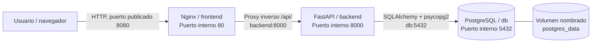

# ACI606 — Docker Rescue Challenge

**Asignatura:** ACI606 — Especialidad II: Cloud Computing  
**Evaluación:** Cátedra 2 — Docker Rescue Challenge  
**Objetivo:** diagnosticar, recuperar, documentar y validar una aplicación web multi-servicio entregada con fallas deliberadas, utilizando Docker Compose.

> **Alcance:** este repositorio conserva la aplicación original proporcionada para la evaluación. Las modificaciones se enfocan en reparar la construcción y ejecución de servicios, su comunicación, configuración, persistencia y capacidad de diagnóstico. El historial de Git registra las reparaciones y mejoras.

## 1. Descripción funcional

El sistema permite visualizar el estado de la API y su conexión a PostgreSQL, crear registros y consultar los registros existentes mediante una interfaz web.

| Componente | Tecnología | Responsabilidad |
|---|---|---|
| Frontend | Nginx 1.27 Alpine + HTML/CSS/JavaScript | Servir la interfaz web y actuar como proxy inverso para `/api/` |
| Backend | Python 3.12, FastAPI, Uvicorn y SQLAlchemy | Exponer la API REST, validar los datos y ejecutar operaciones SQL |
| Base de datos | PostgreSQL 16 Alpine | Almacenar los registros en la tabla `items` |
| Orquestación local | Docker Compose | Construir imágenes, conectar servicios, comprobar su salud y gestionar el volumen persistente |

### 1.1 Arquitectura y tráfico



**Red interna:** Compose conecta los servicios a la red predeterminada del proyecto. Dentro de esa red, los servicios se resuelven mediante los nombres `frontend`, `backend` y `db`. Por este motivo, un contenedor no debe utilizar `localhost` para acceder a otro servicio.

**Publicación de puertos:** el mapeo `8080:80` publica el puerto 80 de Nginx en el puerto 8080 del entorno anfitrión. Los puertos 8000 y 5432 se usan internamente y no se publican directamente en el archivo Compose actual.

**Proxy inverso:** Nginx recibe `/api/health` y lo remite a `http://backend:8000/health`. La barra final de `proxy_pass http://backend:8000/;` es relevante para esta reescritura de rutas.

**Orden de arranque verificado (R-07):** al ejecutar Compose, PostgreSQL debe pasar su comprobación `pg_isready` antes de que empiece FastAPI. El frontend espera a que el healthcheck del backend responda correctamente. Este control se configura mediante `depends_on` con `condition: service_healthy` y evita la falla de conexión inicial detectada en un Codespace nuevo.

### 1.2 Estructura del repositorio

```text
aci606-docker-rescue-catedra2/
├── backend/
│   ├── Dockerfile            # Imagen Python y comando de Uvicorn
│   ├── main.py               # Endpoints, conexión SQL y esquema inicial
│   └── requirements.txt      # Dependencias Python
├── frontend/
│   ├── Dockerfile            # Imagen Nginx y archivos estáticos
│   ├── index.html            # Interfaz web y solicitudes fetch
│   └── nginx.conf            # Nginx y proxy de /api/
├── compose.yaml              # Servicios, volumen, healthchecks y dependencias saludables
├── .env.example              # Plantilla de variables, sin secretos reales
├── .gitignore                # Excluye .env y el respaldo SQL local
├── BITACORA.md               # Diagnóstico y reparaciones R-01 a R-07
└── README.md                 # Manual de construcción, uso y verificación
```

El archivo `.env` es **local y obligatorio para la ejecución**; no se publica en Git. Un respaldo local denominado `respaldo_antes_volumen.sql` puede existir durante las pruebas, pero no forma parte del paquete reproducible.

## 2. Requisitos y entorno de ejecución

- **Opción recomendada:** GitHub Codespaces con Docker Engine y Docker Compose disponibles.
- **Alternativa:** entorno Linux, macOS o Windows con Docker Engine/Desktop, Docker Compose V2 o compatible y acceso a una terminal.
- Acceso al repositorio y permiso para crear el archivo local `.env`.
- Puerto 8080 disponible para acceder al frontend.

Desde la raíz del repositorio (carpeta donde está `compose.yaml`), verificar:

```bash
docker --version
docker compose version
pwd
ls -la
```

Los comandos siguientes están pensados para una terminal **Bash** en Codespaces. En un equipo Windows, pueden variar las operaciones de copia de archivos y el uso de comillas según la consola.

## 3. Configuración inicial desde un Codespace limpio

> **No se requiere una base de datos externa ni un archivo SQL previo.** PostgreSQL crea el almacén inicial; la aplicación genera la tabla `items` durante el arranque del backend.

### 3.1 Crear el archivo de entorno

```bash
cp .env.example .env
```

Abrir `.env` y sustituir **ambas** apariciones de `CAMBIAR_PASSWORD` por una contraseña propia para este entorno. Ejemplo de estructura (los marcadores siguientes **no** son credenciales operativas):

```dotenv
POSTGRES_USER=appuser
POSTGRES_PASSWORD=REEMPLAZAR_CON_PASSWORD_LOCAL
POSTGRES_DB=appdb
DATABASE_URL=postgresql://appuser:REEMPLAZAR_CON_PASSWORD_LOCAL@db:5432/appdb
```

- `POSTGRES_USER`: usuario que PostgreSQL inicializa.
- `POSTGRES_PASSWORD`: contraseña del usuario; se aplica al inicializar una base de datos nueva.
- `POSTGRES_DB`: nombre de la base de datos creada.
- `DATABASE_URL`: URL de conexión que SQLAlchemy utiliza desde el contenedor backend.
- La contraseña de `DATABASE_URL` **debe coincidir** con `POSTGRES_PASSWORD` para un volumen recién inicializado.
- Si se utiliza una contraseña con caracteres reservados de URL (`@`, `:`, `/`, `%`, etc.), codificar esos caracteres correctamente en el componente de contraseña de `DATABASE_URL`.

**Importante para volúmenes existentes:** modificar `POSTGRES_PASSWORD` en `.env` **no cambia automáticamente** la contraseña de una instancia PostgreSQL ya inicializada. No cambies credenciales sobre un volumen con datos sin planificar su actualización en la base de datos.

### 3.2 Revisar configuración sin mostrar secretos

```bash
git check-ignore -v .env
docker compose config --quiet
```

El primer comando debe confirmar que Git ignora `.env`; el segundo no debe reportar errores. **Evitar publicar la salida completa de `docker compose config`**, ya que puede revelar valores resueltos de entorno.

### 3.3 Construir e iniciar el sistema

```bash
docker compose up --build -d
docker compose ps
```

- `--build` construye las imágenes de frontend y backend a partir de sus Dockerfiles.
- `-d` deja los servicios ejecutándose en segundo plano.
- Se esperan los servicios `frontend`, `backend` y `db`.
- PostgreSQL (`db`) y FastAPI (`backend`) deben mostrar **`healthy`** después de superar sus respectivos healthchecks; Nginx (`frontend`) debe aparecer `Up`.
- Compose espera a que la base de datos esté saludable antes de iniciar el backend, y a que el backend esté saludable antes de iniciar Nginx.

**Corrección R-07:** inicialmente, al probar el repositorio en un Codespace nuevo, `backend` terminaba en `Exited (3)` con `connection to server at "db" ... port 5432 failed: Connection refused`. PostgreSQL acababa de crearse y todavía no estaba listo. Tras agregar el healthcheck a `db` y `depends_on: condition: service_healthy`, el inicio con un único `docker compose up --build -d` completó la secuencia sin usar `docker compose start backend` manualmente.

**Importante:** `depends_on` con `service_healthy` controla la preparación durante el arranque; no reinicia automáticamente un servicio que se detenga en cualquier momento posterior. Para verificar el funcionamiento real, también hay que ejecutar las solicitudes HTTP de la sección 4.

### 3.4 Abrir la interfaz web

- **En Codespaces:** abrir la pestaña **Puertos / Ports**, localizar el puerto `8080` y abrir el enlace reenviado.
- **Con Docker local:** acceder a `http://localhost:8080/` desde el navegador del equipo anfitrión.
- **Desde la terminal del entorno Docker:** `http://127.0.0.1:8080/`.

La interfaz debe mostrar el estado del backend, un formulario para crear registros y una lista de registros.

## 4. Contrato de la API y modelo de datos

El backend publica rutas internas sin prefijo `/api`. El frontend las expone con el prefijo `/api/` a través de Nginx.

| Método | Ruta externa | Ruta backend | Función | Respuesta satisfactoria |
|---|---|---|---|---|
| `GET` | `/api/health` | `/health` | Ejecutar `SELECT 1` sobre PostgreSQL y reportar salud | `200`, `{"status":"ok","database":"reachable"}` |
| `GET` | `/api/items` | `/items` | Listar registros ordenados por ID | `200`, arreglo JSON |
| `POST` | `/api/items` | `/items` | Insertar un registro con `name` | `201`, objeto creado |
| `GET` | `/api/` | `/` | Información básica del servicio API | `200`, objeto JSON |

### 4.1 Esquema de persistencia

La aplicación inicializa, si no existe, una tabla equivalente a:

```sql
CREATE TABLE IF NOT EXISTS items (
    id SERIAL PRIMARY KEY,
    name VARCHAR(80) NOT NULL,
    created_at TIMESTAMP NOT NULL DEFAULT CURRENT_TIMESTAMP
);
```

El cuerpo del endpoint `POST /items` exige `name` como cadena de **1 a 80 caracteres**; FastAPI/Pydantic devuelve error de validación para datos que no cumplen esa regla.

### 4.2 Pruebas funcionales HTTP

**Estado de la API y base de datos:**

```bash
curl -i --max-time 10 http://127.0.0.1:8080/api/health
```

Resultado esperado: `HTTP/1.1 200 OK` y un JSON que indique `status: ok` y `database: reachable`.

**Consulta de registros:**

```bash
curl -i --max-time 10 http://127.0.0.1:8080/api/items
```

Una instancia nueva puede responder `[]`, lo que es válido si todavía no hay datos.

**Creación de registro:**

```bash
curl -i --max-time 10 -X POST http://127.0.0.1:8080/api/items \
  -H 'Content-Type: application/json' \
  -d '{"name":"Prueba ACI606"}'
```

Resultado esperado: `HTTP/1.1 201 Created` y un JSON con `id`, `name` y `created_at`. Los identificadores y fechas dependen del estado de la base y **no deben suponerse fijos**.

**Verificación de consulta posterior:**

```bash
curl -sS http://127.0.0.1:8080/api/items | python -m json.tool
```

Debe aparecer el registro creado. Si se repite el `POST`, se creará **otro registro**; no usarlo innecesariamente si se desea conservar una prueba con un solo registro.

## 5. Persistencia de PostgreSQL

Compose declara el volumen nombrado lógico `postgres_data`, montado dentro de PostgreSQL en `/var/lib/postgresql/data`. Docker suele anteponer el nombre del proyecto al nombre físico del volumen, por ejemplo `aci606-docker-rescue-catedra2_postgres_data`.

```bash
docker volume ls
docker compose config --quiet
```

### 5.1 Prueba reproducible de permanencia de datos

1. Crear un registro con el endpoint `POST /api/items`.
2. Comprobarlo mediante `GET /api/items` o una consulta SQL:

   ```bash
   docker compose exec -T db psql -U appuser -d appdb \
     -c 'SELECT id, name, created_at FROM items ORDER BY id;'
   ```

3. Recrear **solo el contenedor** de PostgreSQL sin borrar el volumen:

   ```bash
   docker compose up -d --no-deps --force-recreate db
   ```

4. Comprobar disponibilidad de la base:

   ```bash
   docker compose exec -T db pg_isready -U appuser -d appdb
   ```

5. Si es necesario, asegurar que los demás servicios estén iniciados:

   ```bash
   docker compose up -d
   ```

6. Repetir la consulta SQL y `GET /api/items`. El registro creado debe seguir presente con el mismo `id` y `created_at`.

**Advertencia:** `docker compose down -v` elimina volúmenes administrados por Compose y puede borrar los datos. **No utilizarlo** como parte de esta prueba.

### 5.2 Respaldo SQL (opcional, antes de cambios destructivos)

```bash
docker compose exec -T db pg_dump -U appuser -d appdb > respaldo_antes_volumen.sql
```

Conservar una copia segura fuera del repositorio. La restauración en una base **vacía** puede realizarse con:

```bash
docker compose exec -T db psql -v ON_ERROR_STOP=1 -U appuser -d appdb < respaldo_antes_volumen.sql
```

**No repetir la restauración sobre una tabla ya creada**, porque un respaldo con instrucciones `CREATE TABLE` puede producir `relation "items" already exists`.

## 6. Healthchecks, dependencias y observabilidad

En la versión final, `compose.yaml` incluye dos comprobaciones de salud:

- **PostgreSQL (`db`):** ejecuta `pg_isready` dentro del contenedor para comprobar que el servidor acepta conexiones. Usa `interval: 5s`, `timeout: 5s`, `retries: 10` y `start_period: 10s`.
- **FastAPI (`backend`):** utiliza Python `urllib.request` para consultar `http://127.0.0.1:8000/health` dentro del propio contenedor. Usa `interval: 10s`, `timeout: 5s`, `retries: 5` y `start_period: 15s`.

La ruta `/health` del backend ejecuta `SELECT 1` en PostgreSQL; si ocurre un problema de conexión, informa un error y su healthcheck no se supera.

### 6.1 Dependencias entre servicios

```yaml
frontend:
  depends_on:
    backend:
      condition: service_healthy

backend:
  depends_on:
    db:
      condition: service_healthy
```

La configuración anterior es un **extracto** para explicar las dependencias; el archivo completo se encuentra en `compose.yaml`. Primero se espera la salud de PostgreSQL, después la de FastAPI y finalmente se inicia Nginx.

Esta mejora se incorporó después de detectar una condición de carrera en el primer arranque de un Codespace nuevo. Con el `depends_on` anterior, los contenedores podían iniciar en orden sin que la base de datos aceptara conexiones todavía.

### 6.2 Consultar el estado y los logs

```bash
docker compose ps
docker compose ps -a
docker compose logs --tail=80 db
docker compose logs --tail=80 backend
```

Inspeccionar los resultados internos de los healthchecks:

```bash
docker inspect --format '{{json .State.Health}}' "$(docker compose ps -q db)"
docker inspect --format '{{json .State.Health}}' "$(docker compose ps -q backend)"
```

El estado `healthy` informa que pasó la comprobación configurada, no que todas las funciones de la aplicación hayan sido probadas. La respuesta HTTP 200 de `/api/health` y las operaciones con `/api/items` permiten validar el recorrido real de la API.

## 7. Diagnóstico de incidencias y trazabilidad

Para cada incidencia de Cátedra 2 documentar **síntoma → evidencia → causa raíz → modificación → justificación → verificación → impacto**. Las capturas, logs y mensajes de commit deben permitir reconstruir la secuencia de trabajo.

| ID | Síntoma / evidencia observada | Causa raíz | Corrección aplicada | Verificación posterior |
|---|---|---|---|---|
| R-01 | `Could not import module "app"` | El comando de Uvicorn apuntaba al módulo incorrecto | `backend/Dockerfile`: `app:app` → `main:app` | Desapareció el error de importación; el arranque avanzó al siguiente fallo |
| R-02 | `No module named 'psycopg2'` | Faltaba el driver PostgreSQL del backend | Se añadió `psycopg2-binary` a `backend/requirements.txt` | El siguiente fallo pasó a ser de conexión a BD |
| R-03 | Conexión rechazada a `localhost:5432` | `localhost` identificaba al propio backend, no a PostgreSQL | `DATABASE_URL` pasó a utilizar `db:5432` | El servidor PostgreSQL respondió, pero rechazó la autenticación |
| R-04 | `password authentication failed for user "appuser"` | Credenciales del backend y PostgreSQL inconsistentes | Se igualaron las credenciales del entorno | Uvicorn completó el arranque y el backend pasó a `Up` |
| R-05 | La publicación `8080:8080` no coincidía con Nginx `listen 80` | Mapeo externo/interno incorrecto | `compose.yaml`: `8080:80` | `GET /` respondió `HTTP 200` |
| R-06 | `GET /api/health` devolvía `502 Bad Gateway` | Nginx usaba `localhost:8000` como upstream | `frontend/nginx.conf`: `proxy_pass http://backend:8000/;` | `/api/health` y `/api/items` respondieron `HTTP 200` |
| R-07 | En Codespace nuevo: backend `Exited (3)` y `Connection refused` a `db:5432` | `depends_on` simple iniciaba el backend antes de que PostgreSQL estuviera preparado | `compose.yaml`: healthcheck `pg_isready` y dependencias `condition: service_healthy` | Arranque automático con tres servicios `Up`, `db` y `backend` `healthy`, `/api/health` HTTP 200 |

**Mejoras posteriores:** volumen nombrado para PostgreSQL; `.env` y `.env.example` para configuración; healthcheck del backend y de PostgreSQL; dependencias `service_healthy`; README reproducible. Se verificaron comunicación, persistencia, fallo controlado, diagnóstico, recuperación y el arranque en un Codespace nuevo. La incidencia R-07 quedó registrada en el commit `c7535dd`.

**Nota de historial:** `BITACORA.md` documenta un commit etiquetado accidentalmente como R-04 que en realidad correspondía al cambio R-05. Se conservó el commit original y se registró una aclaración, sin reescribir el historial compartido.

### 7.1 Comandos de diagnóstico

```bash
# Estado de todos los contenedores, incluidos los detenidos
docker ps -a
docker compose ps -a

# Registros por servicio
docker compose logs --tail=80 frontend
docker compose logs --tail=80 backend
docker compose logs --tail=80 db

# Configuración resultante (ATENCIÓN: puede exponer secretos)
docker compose config

# Inspección de contenedor
# Sustituir por el ID obtenido de 'docker compose ps -q backend'
docker inspect "$(docker compose ps -q backend)"

# Ingresar al contenedor para inspección (no para iniciar servicios manualmente)
docker compose exec backend sh

# Redes y almacenamiento
docker network ls
docker volume ls
```

Para inspeccionar una red o volumen concreto, primero obtener su nombre real con `docker network ls` o `docker volume ls` y después ejecutar `docker network inspect NOMBRE` o `docker volume inspect NOMBRE`.

## 8. Prueba de fallo controlado y recuperación

Esta prueba **se ejecutó en el entorno de evaluación**. El objetivo fue observar el efecto de detener el backend mientras el frontend y la base de datos permanecían activos.

### 8.1 Estado anterior al fallo

```bash
docker compose ps
curl -i --max-time 10 http://127.0.0.1:8080/api/health
```

Antes de la interrupción, el backend figuraba `healthy` y `/api/health` respondió `HTTP/1.1 200 OK`.

### 8.2 Simular fallo de backend

```bash
docker compose stop backend
docker compose ps -a
curl -i --max-time 5 http://127.0.0.1:8080/api/health
docker compose logs --tail=50 frontend
```

**Resultados observados:** el contenedor `backend` pasó a `Exited (0)`, mientras `frontend` y `db` continuaron `Up`. La solicitud a `/api/health` agotó los cinco segundos del cliente: `curl: (28) Operation timed out after 5002 milliseconds with 0 bytes received`. Los logs de Nginx registraron `499`, porque el cliente cerró su conexión antes de recibir respuesta.

En otras condiciones Nginx podría devolver un `502 Bad Gateway`, pero **no fue el código observado en esta prueba concreta**.

### 8.3 Recuperar

```bash
docker compose start backend
docker compose ps
curl -i --max-time 10 http://127.0.0.1:8080/api/health
curl -i --max-time 10 http://127.0.0.1:8080/api/items
```

**Resultado observado:** el backend regresó a `Up (healthy)` y `/api/health` volvió a `HTTP/1.1 200 OK`, con `{"status":"ok","database":"reachable"}`. El escenario muestra la interrupción, el diagnóstico con logs y la recuperación. Si el backend acaba de reiniciarse, puede ser necesario comprobar su salud antes de consultar la API.

## 9. Detención, reconstrucción y reproducibilidad

| Objetivo | Comando | Efecto esperado |
|---|---|---|
| Detener procesos sin eliminar contenedores | `docker compose stop` | Conserva contenedores y volumen |
| Reiniciar contenedores detenidos | `docker compose start` | Reutiliza los existentes |
| Eliminar contenedores/red del proyecto | `docker compose down` | Mantiene el volumen nombrado por defecto |
| Construir e iniciar/recrear servicios | `docker compose up --build -d` | Levanta la aplicación desde la configuración del repositorio |
| Ver estado | `docker compose ps` | Muestra los servicios y los healthchecks de PostgreSQL y FastAPI |

### 9.1 Prueba desde un Codespace limpio (entrega)

1. Abrir una instancia nueva de Codespaces para la rama `main`.
2. Crear `.env` a partir de `.env.example` y completar los valores (el archivo `.env` no está versionado).
3. Ejecutar **desde la raíz del repositorio**:

   ```bash
   docker compose config --quiet
   docker compose up --build -d
   docker compose ps
   ```

4. Comprobar que `db` y `backend` estén `healthy` y que `frontend` esté `Up`. Validar:

   ```bash
   curl -i http://127.0.0.1:8080/api/health
   curl -i http://127.0.0.1:8080/api/items
   ```

5. Guardar los comandos, resultados y capturas del arranque para el informe. Si se trata de un volumen nuevo, el resultado inicial de `GET /api/items` puede ser `[]`; esto no contradice la prueba de persistencia realizada en el Codespace anterior.

**Resultado real de la validación (22-11-2026):** en un Codespace nuevo, la primera ejecución dejó el backend detenido porque intentó conectarse a PostgreSQL demasiado pronto. Después de aplicar la reparación R-07 y reiniciar los contenedores conservando el volumen, se ejecutó nuevamente `docker compose up --build -d`: la terminal informó `Container ...-db-1 Healthy`, `Container ...-backend-1 Healthy` y `Container ...-frontend-1 Started`. `docker compose ps` confirmó ambos healthchecks y `curl` a `/api/health` devolvió `HTTP/1.1 200 OK`. El commit final de esa reparación es `c7535dd`.

**Nota sobre el criterio del profesor:** el comando obligatorio de arranque sigue siendo `docker compose up --build -d`. Crear `.env` a partir de `.env.example` es una preparación local indispensable, ya que el repositorio no distribuye contraseñas operativas. La ejecución final se realizó en ese Codespace nuevo con la base ya inicializada durante los intentos anteriores. Por tanto, demuestra que el arranque ahora funciona automáticamente en ese entorno, pero **no equivale todavía a repetir la prueba después de R-07 con un volumen totalmente nuevo**. No se debe afirmar que el primer intento sin R-07 funcionó.

## 10. Seguridad y limitaciones

- `.env` y los respaldos SQL deben mantenerse fuera de Git. El archivo `.env.example` solo incluye marcadores.
- Las credenciales de laboratorio utilizadas durante la reparación quedaron anteriormente visibles en commits/capturas. **No deben reutilizarse en otros servicios**. Si son credenciales reales, requieren rotación y tratamiento del historial expuesto.
- El archivo `backend/main.py` conserva un valor predeterminado de conexión en el código original. La ejecución mediante Compose utiliza la variable `DATABASE_URL`; como mejora de seguridad adicional, conviene eliminar el valor de respaldo embebido y exigir la variable en todos los modos de ejecución.
- PostgreSQL y FastAPI no se publican directamente en puertos del host en la configuración actual; se accede a la API a través de Nginx.
- La solución está diseñada para una evaluación Docker Compose. No incluye Kubernetes, pipeline CI/CD, copias programadas, monitoreo centralizado ni despliegue productivo endurecido.
- La inicialización automática de `items` en el evento de inicio no sustituye un sistema completo de migraciones de base de datos.

## 11. Evidencias y entregables de Cátedra 2

**Repositorio GitHub:** código recuperado, Dockerfiles, `compose.yaml`, `.env.example`, README y commits descriptivos.  
**Informe PDF:** arquitectura inicial y final, metodología de diagnóstico, bitácora por incidencia con causa y verificación, pruebas obligatorias, mejoras y conclusiones.

Pruebas mínimas de la evaluación:

- Arranque limpio con `docker compose up --build -d`.
- Comunicación de frontend, backend y PostgreSQL.
- Persistencia del dato tras recrear el contenedor asociado.
- Fallo controlado de un servicio.
- Diagnóstico mediante estados/logs/inspección.
- Recuperación y nueva verificación de funcionamiento.

La evidencia debe registrar **comandos y salidas reales**, no resultados supuestos. El historial de commits y la bitácora permiten relacionar cada modificación con su incidencia.
